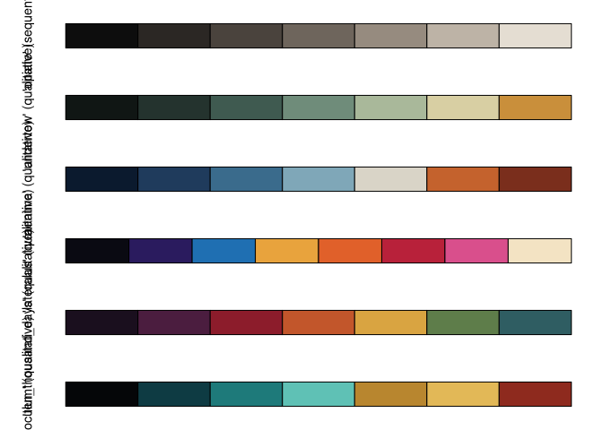
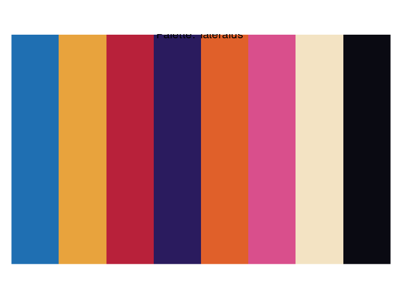
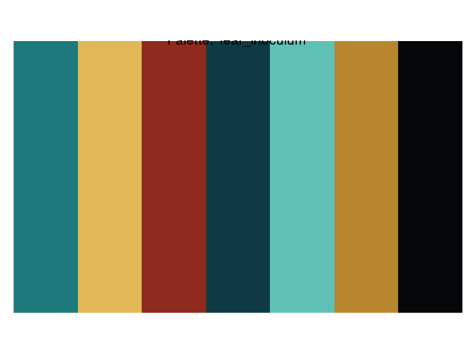
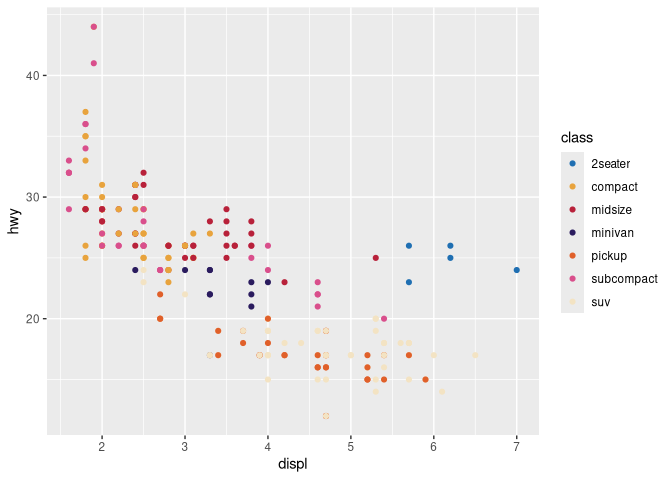
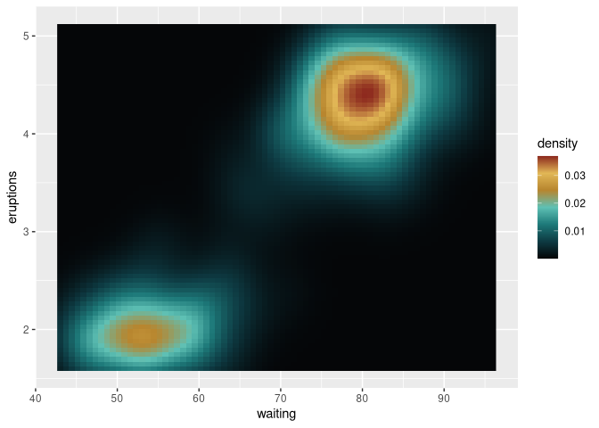
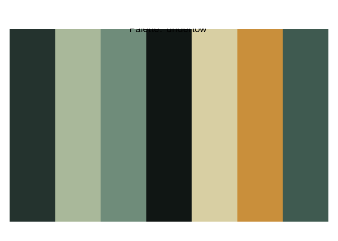

<!-- README.md is generated from README.qmd. Please edit that file -->

# toolcolors

<!-- badges: start -->

[](https://github.com/ekholme/toolcolors/actions/workflows/R-CMD-check.yaml)
<!-- badges: end -->

This package provides color palettes and `ggplot2` color and fill scales
inspired by the album artwork of Tool.

**Disclaimer:** This package is not affiliated with or endorsed by Tool
or the artists. Palettes are interpretations inspired by the artwork.

## Installation

You can install the development version of toolcolors from
[GitHub](https://github.com/) with:

``` r
# install.packages("pak")
pak::pak("ekholme/toolcolors")
```

## Example palettes

See all palettes at once:

``` r
library(toolcolors)
display_all()
```



Or display individual palettes:

``` r
print(tool_palette("lateralus"))
```



``` r
print(tool_palette("fear_inoculum"))
```



## Usage

### Discrete scales

``` r
library(ggplot2)
ggplot(mpg, aes(displ, hwy, color = class)) +
  geom_point() +
  scale_color_tool_d("lateralus")
```



### Continuous scales

``` r
ggplot(faithfuld, aes(waiting, eruptions, fill = density)) +
  geom_raster() +
  scale_fill_tool_c("fear_inoculum")
```



### Reverse direction

``` r
print(tool_palette("undertow", direction = -1))
```


